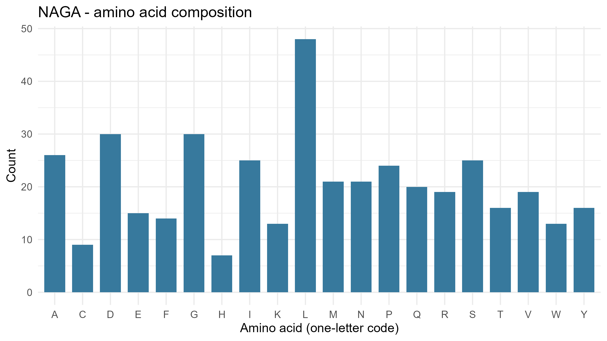
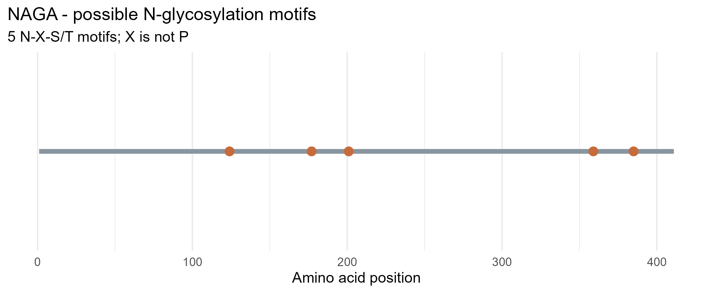

# Lysosomal Enzyme Analysis: alpha-N-acetylgalactosaminidase (NAGA)

Individual lab activity for Cell & Molecular Biology, using NCBI Protein and R to analyze a human lysosomal enzyme.

**Name:** Obiñeta, Inah Marie  

**Date Completed:** October 14, 2026  

**Gene:** NAGA (alpha-N-acetylgalactosaminidase)


## Enzyme summary

- **Enzyme:** alpha-N-acetylgalactosaminidase (also called alpha-galactosidase B)

- **Gene symbol:** *NAGA* (NCBI Gene ID 4668)

- **NCBI protein record:** [NP_000253.1](https://www.ncbi.nlm.nih.gov/protein/NP_000253.1) (human RefSeq precursor, 411 aa)

- **Function:** A lysosomal hydrolase that removes alpha-N-acetylgalactosaminyl (N-acetylgalactosamine) groups from glycoconjugates such as glycoproteins and glycolipids, so the sugar chains can be broken down and recycled.


## Step-by-step workflow (what I ran and what it produced)

The whole analysis was run in RStudio (R 4.3.2) using `lysosomal_enzyme_analysis.R`. The sequence was downloaded from NCBI **by the script itself** (using the `rentrez` package), not copied by hand. Each step below shows the code, then the actual output I got.

### Step 1. Choose the enzyme and record the accession

I chose *NAGA* because it was not taken by other classmates. On NCBI Protein I searched `NAGA Homo sapiens` and selected the full-length human RefSeq record **NP_000253.1** (411 aa, MANE Select). Other NAGA records, such as the GenBank clone CAG30413.1, were not used because they are not RefSeq (NP_) entries.

### Step 2. Edit the two lines at the top of the script

```r
gene <- "NAGA"
accession <- "NP_000253.1"
```

Nothing else in the script was changed.

### Step 3. Install packages (once) and check them

```r
install.packages(c("rentrez", "ggplot2"))
```

The script then checks that both packages are available. It stops with an error if one is missing, so a successful run confirms both were installed.

### Step 4. Download the protein sequence from NCBI through R

```r
fasta <- rentrez::entrez_fetch(db = "protein", id = accession,
                               rettype = "fasta", retmode = "text")
writeLines(fasta, file.path("data", paste0(gene, ".fasta")))
```

This calls the NCBI Protein database with the accession and saves the result as `data/NAGA.fasta`. The script also checks that exactly one FASTA record was returned. The first lines of the downloaded file are:

```
>NP_000253.1 alpha-N-acetylgalactosaminidase precursor [Homo sapiens]
MLLKTVLLLGHVAQVLMLDNGLLQTPPMGWLAWERFRCNINCDEDPKNCISEQLFMEMADRMAQDGWRDM
GYTYLNIDDCWIGGRDASGRLMPDPKRFPHGIPFLADYVHSLGLKLGIYADMGNFTCMGYPGTTLDKVVQ
...
```

The header matches the NCBI record, which confirms the correct protein was downloaded.

### Step 5. Count the sequence length and amino acids

```r
amino_acids <- strsplit(protein, "", fixed = TRUE)[[1]]
protein_length <- length(amino_acids)
counts <- table(factor(amino_acids, levels = standard_aa))
```

Result: the protein is **411 amino acids** long, matching the NCBI record. The five most common amino acids printed in the R console were:

```
 amino_acid count percent
          L    48   11.68
          D    30    7.30
          G    30    7.30
          A    26    6.33
          I    25    6.08
```

The full counts for all 20 amino acids are saved in `results/NAGA_amino_acid_counts.csv`.

### Step 6. Search for potential N-glycosylation motifs

```r
positions <- i[amino_acids[i] == "N" &
               amino_acids[i + 1L] %in% setdiff(standard_aa, "P") &
               amino_acids[i + 2L] %in% c("S", "T")]
```

The code looks for every asparagine (N) followed by any amino acid except proline, then a serine (S) or threonine (T). It found **5 motifs** (positions 124, 177, 201, 359, 385; see the tables below). The console summary printed:

```
  gene   accession length_amino_acids potential_N_glycosylation_motifs
1 NAGA NP_000253.1                411                                5
```

As a check, I also searched the downloaded FASTA sequence separately and found the same 5 positions.

### Step 7. Save the tables and make the figures

The script wrote three CSV files to `results/` and two figures to `figures/` (Figures 1 and 2 below). The console ended with `Files saved in data/, results/, and figures/.`, which confirms the run finished without errors.

### Output files

| Step | File produced |
|---|---|
| 4 | `data/NAGA.fasta` |
| 5-6 | `results/NAGA_summary.csv`, `results/NAGA_amino_acid_counts.csv`, `results/NAGA_motif_positions.csv` |
| 7 | `figures/NAGA_amino_acid_composition.png`, `figures/NAGA_potential_N_glycosylation.png` |

## Results

**Summary** (`results/NAGA_summary.csv`)

| gene | accession | length_amino_acids | potential_N_glycosylation_motifs |
|------|-----------|--------------------|----------------------------------|
| NAGA | NP_000253.1 | 411 | 5 |

**Potential N-glycosylation motifs** (`results/NAGA_motif_positions.csv`)

| position | motif |
|----------|-------|
| 124 | NFT |
| 177 | NAT |
| 201 | NYS |
| 359 | NFT |
| 385 | NFT |

**Amino acid counts** (`results/NAGA_amino_acid_counts.csv`)

| amino_acid | count | percent |
|------------|-------|---------|
| A | 26 | 6.33 |
| C | 9 | 2.19 |
| D | 30 | 7.30 |
| E | 15 | 3.65 |
| F | 14 | 3.41 |
| G | 30 | 7.30 |
| H | 7 | 1.70 |
| I | 25 | 6.08 |
| K | 13 | 3.16 |
| L | 48 | 11.68 |
| M | 21 | 5.11 |
| N | 21 | 5.11 |
| P | 24 | 5.84 |
| Q | 20 | 4.87 |
| R | 19 | 4.62 |
| S | 25 | 6.08 |
| T | 16 | 3.89 |
| V | 19 | 4.62 |
| W | 13 | 3.16 |
| Y | 16 | 3.89 |

## Figures

**Figure 1. Amino acid composition of NAGA (NP_000253.1)**



*Figure 1 shows how many times each of the 20 amino acids appears in the 411-aa NAGA precursor. Leucine is the most abundant (48), followed by aspartate and glycine (30 each). Histidine (7) and cysteine (9) are the least common.*

*Explanation:* This bar chart shows how many times each of the 20 amino acids appears in the 411-residue NAGA precursor. Leucine (L) is the most abundant at 48 residues (11.68%), followed by aspartate (D) and glycine (G) at 30 each (7.30%), alanine (A) at 26 (6.33%), and isoleucine (I) and serine (S) at 25 each (6.08%). The least common are histidine (H, 7; 1.70%) and cysteine (C, 9; 2.19%). The composition describes the sequence only and does not show how the protein folds or how active it is.

**Figure 2. Positions of potential N-glycosylation motifs (N-X-S/T, X is not P)**



*Figure 2 maps the 5 potential N-X-S/T motifs along the protein (positions 124, 177, 201, 359, and 385). Three lie in the middle region and two near the C-terminal end. These are only potential sites and do not prove that glycans are attached.*

## Answers

**1. What does your enzyme normally break down inside lysosomes?**

NAGA removes terminal alpha-N-acetylgalactosaminyl (N-acetylgalactosamine) groups from glycoconjugates, meaning glycoproteins and glycolipids. This trimming lets lysosomes continue degrading these sugar-containing molecules so their components can be recycled.

**2. What is the total length of your protein, and which amino acids are most common?**

The NAGA precursor protein (NP_000253.1) is 411 amino acids long. The most common amino acids are leucine (L, 48; 11.68%), aspartate (D, 30; 7.30%) and glycine (G, 30; 7.30%) tied for second, alanine (A, 26; 6.33%), and isoleucine (I, 25; 6.08%).

**3. How many potential N-glycosylation motifs did you find? Where are they located?**

I found 5 potential N-X-S/T motifs (X is not proline). Positions refer to the asparagine (N) in the 411-aa precursor sequence:

| Position | Motif |
|---|---|
| 124 | NFT |
| 177 | NAT |
| 201 | NYS |
| 359 | NFT |
| 385 | NFT |

Three motifs lie in the middle region (124, 177, 201) and two near the C-terminal end (359, 385). No motifs were found in the first 120 residues.

**4. Why can glycosylation matter for lysosomal proteins? Does finding a motif prove the protein is glycosylated?**

Lysosomal enzymes are made in the endoplasmic reticulum and pass through the Golgi, where N-linked glycans are added. These glycans can help with proper folding and stability, and in many lysosomal enzymes they are modified to carry a mannose-6-phosphate tag, which directs the enzyme to lysosomes. Finding an N-X-S/T motif does not prove glycosylation. It only shows a sequence that could be a site. Whether a glycan is actually attached depends on factors such as the local structure and whether the site is accessible in the cell, and it needs experimental evidence. A motif also does not show that a mannose-6-phosphate tag is present.

**5. What could happen in the cell if your enzyme did not work properly?**

If NAGA activity were lost or reduced, its substrates would not be fully broken down and would accumulate in lysosomes. Mutations in *NAGA* cause Schindler disease (types I and II; type II is also called Kanzaki disease), which is a lysosomal storage disorder.

## Notes and limitations

- N-X-S/T is a potential N-glycosylation motif, not confirmation of a glycan or a mannose-6-phosphate tag.
- Protein sequence analysis does not directly measure enzyme activity.
- The analyzed sequence is the full precursor (including the signal peptide), so positions use precursor numbering.

## Reproduce

```
install.packages(c("rentrez", "ggplot2"))
```

Then run `Rscript lysosomal_enzyme_analysis.R` from the repository folder.
